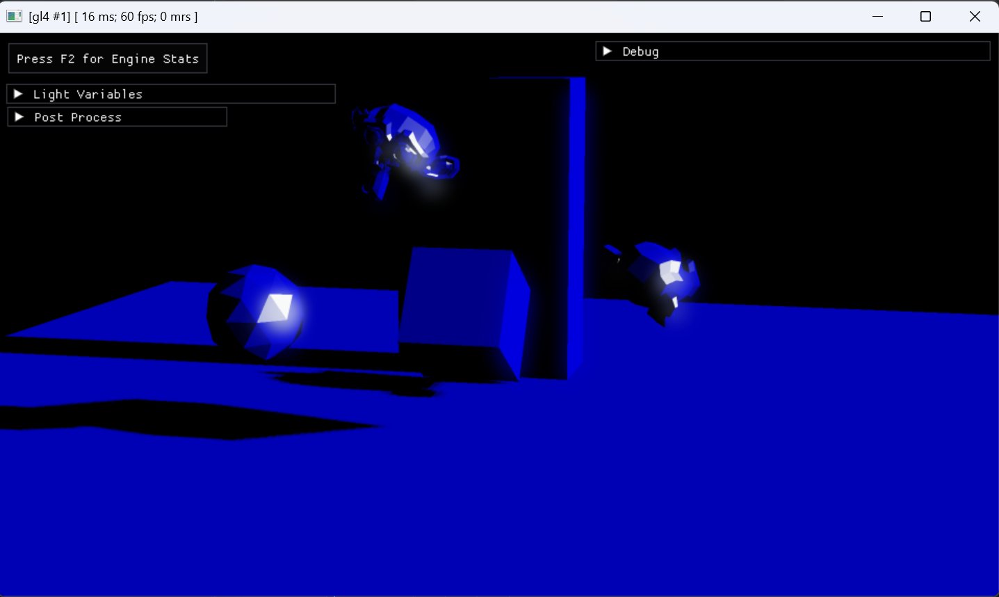
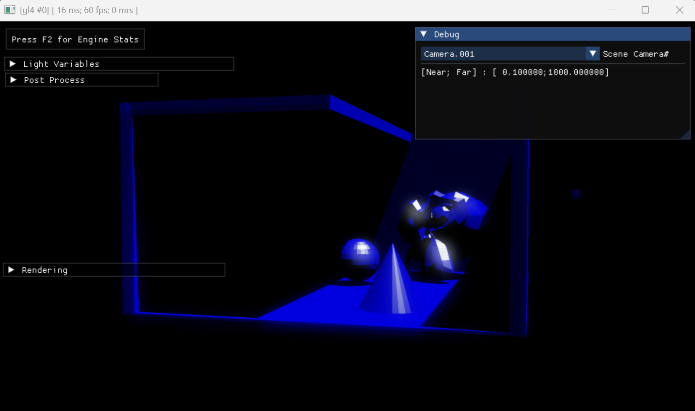

# Camera and shadow mapping examples

These three applications demonstrate camera movement and shadow mapping in motor.
The shadow mapping examples use imported glTF scenes, the scene graph, msl shaders
and the HDR postprocessing pipeline.

| Application | Camera setup | Main purpose |
| --- | --- | --- |
| [00_camera_movement](00_camera_movement.cpp) | Free camera and animated spline camera | Keyboard/mouse camera control and visualizing camera motion. |
| [01_shadow_mapping](01_shadow_mapping.cpp) | Imported camera named `cam.sun` | Shadow mapping using an explicitly authored light camera. |
| [02_camera_fit_shadow_mapping](02_camera_fit_shadow_mapping.cpp) | Generated from the scene bounds and a directional light | Automatic shadow-camera fitting, with scene culling bounds and position/normal visualization. |

## 00_camera_movement

Demonstrates moving a free camera with keyboard input and rotating it with the
mouse. A second camera follows animated spline paths; primitive rendering
visualizes the paths and camera view volume.

| Input | Action |
| --- | --- |
| `W` / `S` | Move forward / backward |
| `A` / `D` | Move sideways |
| `Q` / `E` | Move along the vertical axis |
| Right mouse button + mouse movement | Rotate the free camera |
| Left Ctrl + horizontal mouse movement | Roll the free camera |
| `1` | Select the free camera |
| `2` | Select the animated camera |
| `3` | Cycle between cameras |

Movement and rotation controls apply while the free camera is selected. The
debug UI also provides camera position and orthographic/perspective controls.

## 01_shadow_mapping

<!-- Screenshot placeholder: add images/01_shadow_mapping.png. -->


The original shadow mapping example imports geometry, cameras and animation from
[shadow_mapping_scene.gltf](working/assets/shadow_mapping_scene.gltf). It uses the
imported `cam.sun` camera to render the scene into a depth texture, then evaluates
that texture in the lighting pass from the selected viewing camera.

- Scene graph rendering with separate shadow-depth, scene-depth and lighting passes.
- Imported animation driven through the wire system.
- Camera selection and adjustable light parameters, including shadow bias.
- HDR postprocessing controls and a temporary render-target preview.

The shaders are in [working/01_shadow_mapping/shaders](working/01_shadow_mapping/shaders).
The scene must provide the `cam.sun` camera; this example does not fit a shadow
camera automatically.

## 02_camera_fit_shadow_mapping

<!-- Screenshot placeholder: add images/02_camera_fit_shadow_mapping.png. -->


**This second shadow mapping application tests automatic camera fitting to scene
culling bounds.** It creates an orthographic shadow camera for a directional
light from the imported scene's aggregate AABB, rather than requiring a separate
light camera authored in Blender. Debug views expose the bounds, camera frustum,
world-space positions and normals.

The application originated as `02_reflective_shadow_mapping`. That RSM experiment
was abandoned before indirect illumination was implemented; its additional
render targets remain available for inspection. This is a shadow mapping and
camera-fit test, not a completed RSM/GI implementation.

The scene is imported from [scene.gltf](working/02_camera_fit_shadow_mapping/scene.gltf).
Shaders are in [working/02_camera_fit_shadow_mapping/shaders](working/02_camera_fit_shadow_mapping/shaders).

### Automatic shadow camera from scene bounds

The central feature is constructing an orthographic shadow camera from the
scene's aggregate world-space culling AABB. No separate Sun camera needs to be
authored in Blender.

1. Import local geometry bounds, transform them and propagate their union through the scene graph using `trafo_visitor`.
2. Select the first shadow-casting directional light collected from the scene.
3. Orient the Sun camera using the transformed light direction. The direction is negated for the current `look_at_by_dir()` convention.
4. Transform the world AABB into light-view space, producing an OBB, then enclose it in a view-space AABB.
5. Derive orthographic width, height and depth range from that view-space AABB, including a safety margin.
6. Center the camera laterally, place it in front of the bounds and transform that position back to world space.
7. Use the generated camera for shadow rendering and its matrices for the lighting pass.

The fit is recomputed from the current scene bounds. It is a tight-fit experiment,
not a texel-stabilized or cascaded shadow-map implementation.

### Bounds and render-target visualization

- `Render Debug`, `Render Leafs` and `Render Level` expose scene graph debug drawing, including bounds and the generated Sun-camera frustum.
- The camera selection includes the generated `sun cam`, allowing inspection from the light's viewpoint.
- `Render Normals`, `Render Default` and `Render Light` provide separate scene views.
- The `Render target` list selects shadow depth, positions, normals or an HDR target. Selecting an entry enables the temporary preview; the checkbox in `Post Process` disables it again.

The shadow framebuffer retains the additional outputs from the RSM experiment:

| Attachment | Stored data |
| --- | --- |
| Depth | Shadow depth |
| Color 0, float | World-space positions |
| Color 1, float | Normalized world-space normals |

The shader is still named `rsm_pass`, and the list retains the RSM labels.
Positions and normals are raw data, not display colors. Their direct preview may
clip negative values or values above one; a diagnostic remapping is needed to
visualize the full range. No reflected-flux target or indirect-light gathering
pass is implemented.

## Build

All three targets are defined in this directory's [CMakeLists.txt](CMakeLists.txt).
From the repository root, with an existing configured build directory:

```sh
cmake --build <build-dir> --config Debug --target 00_camera_movement 01_shadow_mapping 02_camera_fit_shadow_mapping
```

The shadow mapping examples use motor's IO database to access the assets under `working`.
They are interactive visual tests, not automated image-comparison tests.
